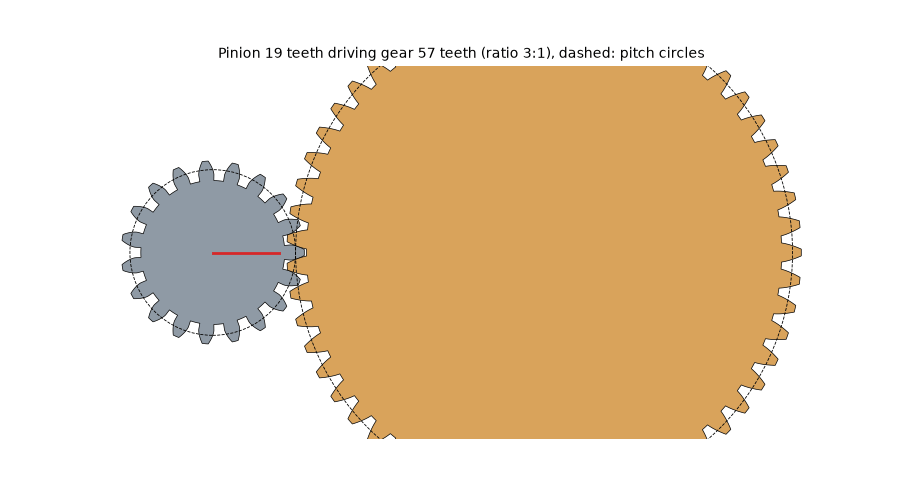
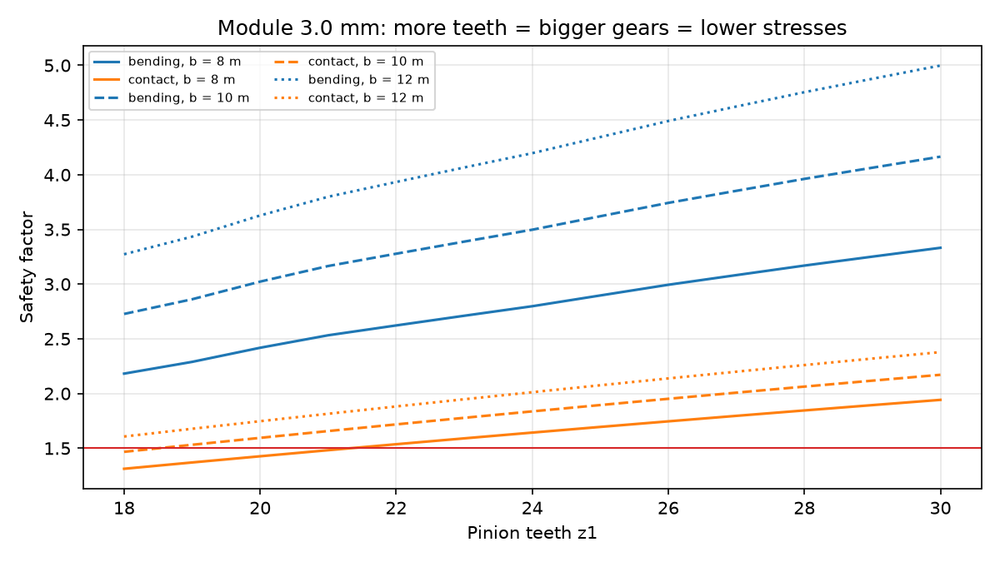
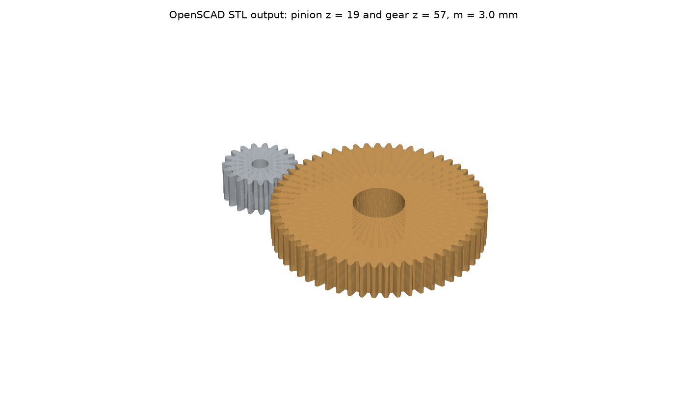

# Spur Gear Pair: Python Sizing + Parametric OpenSCAD CAD

A gear reduction designed end to end from code. Python sizes the gear pair for a real motor with tooth bending and surface contact checks, then drives **OpenSCAD from the command line** to generate the involute gears as STL solids and SVG profiles. The exported geometry is measured and verified against gear theory.



**3D models:** [`results/pinion.stl`](results/pinion.stl) and [`results/gear.stl`](results/gear.stl) (GitHub renders STL files interactively).

## The problem

An electric motor of **5 kW at 1450 rpm** drives a machine through a **3:1** spur gear reduction. Find the lightest steel gear pair that survives both classic gear failure modes with a safety factor of 1.5:

- **Tooth bending** (the tooth breaking at its root), checked with the Lewis equation
- **Surface contact** (pitting of the flanks), checked with the Hertz contact stress

| Input | Value |
|---|---|
| Pressure angle | 20° full depth |
| Allowable bending stress | 200 MPa (through-hardened steel, illustrative) |
| Allowable contact stress | 900 MPa (through-hardened steel, illustrative) |
| Search space | module 1.5 to 4 mm, pinion 18 to 30 teeth, face width 8, 10 or 12 × module (195 pairs) |

The pinion has at least 18 teeth, so the 20° teeth have no undercut (the theoretical minimum is about 17).

## Method

**Sizing (Python):**
- Torque T = P/ω and tangential force Ft = 2T/d₁ on the pitch circle
- Dynamic effect from the pitch line speed with the Barth velocity factor Kv = (6.1 + v)/6.1
- Lewis bending: σF = Kv·Ft / (b·m·Y), with the Lewis form factor Y(z) from Shigley's table, checked on the pinion (fewer teeth, weaker tooth)
- Hertz contact: σH = Z_E·Z_H·√(Kv·Ft·(u+1) / (b·d₁·u)), with Z_E = 189.8 √MPa (steel on steel) and Z_H = 2.495 (20° spur)
- Contact ratio εα from the tip and base circles, to check smooth running

**CAD (OpenSCAD):** [`gear.scad`](gear.scad) builds a true involute profile from the involute function inv(α) = tan α − α, with addendum m, dedendum 1.25 m and zero backlash. All parameters are set from Python on the command line:

```bash
openscad -o pinion.stl -D m=3 -D z=19 -D b=30 -D bore=14.2 -D mode=3 gear.scad   # solid
openscad -o pinion.svg -D m=3 -D z=19 -D mode=2 gear.scad                        # 2D profile
```

## Results

**Lightest pair that passes both checks:**

| | Value |
|---|---|
| Module | 3 mm |
| Teeth | pinion 19, gear 57 |
| Face width | 30 mm |
| Pitch diameters | 57 / 171 mm, centre distance 114 mm |
| Pinion torque / tangential force | 32.9 N·m / 1155 N |
| Pitch line speed | 4.33 m/s (Kv = 1.71) |
| Bending stress | 69.9 MPa, **SF 2.86** |
| Contact stress | 588 MPa, **SF 1.53** |
| Contact ratio | 1.66 |
| Mass of the pair | 5.6 kg |

**The governing failure mode is surface contact (pitting), not tooth breakage.** Bending has almost twice the required margin, while contact sits right at the limit. This is typical of steel gears: contact stress scales with 1/√(b·d₁), so it is controlled by the pinion diameter, while bending is controlled by the module. That is why the optimum uses a large module (3 mm) with few teeth: it gives the pinion diameter that contact needs without adding width.

A contact ratio of 1.66 means that, on average, 1.66 tooth pairs share the load, so there is always at least one pair in contact and the transmission runs smoothly.






## Verification of the CAD geometry

The exported files are measured and compared with gear theory:

| Part | Teeth counted | Tip radius (measured / theory) | Root radius (measured / theory) | Tooth thickness on the pitch circle (measured / πm/2) | Volume STL vs SVG area × width |
|---|---|---|---|---|---|
| Pinion | 19 | 31.500 / 31.500 | 24.750 / 24.750 | 4.7114 / 4.7124 | +0.011% |
| Gear | 57 | 88.500 / 88.500 | 81.750 / 81.750 | 4.7111 / 4.7124 | +0.011% |

- The tooth thickness is found by intersecting the exported profile with the pitch circle; the 0.02% difference comes from the polygon approximation of the involute (14 points per flank).
- The STL volume is computed with the divergence theorem (sum of signed tetrahedra), which also confirms that the solid is closed and correctly oriented.

## How to run

```bash
sudo apt install openscad
pip install numpy matplotlib
python gear_design.py
```

It takes about 15 seconds. Figures, STL files and the report go to `results/`.

## Limitations

- Lewis and Hertz with a velocity factor are classic first-pass methods. A final design would follow AGMA 2001 or ISO 6336, with load distribution, overload, size, reliability and life factors and real material data.
- Zero backlash and no profile shift or tip relief.
- Possible extensions: helical gears, profile shift to balance bending strength, and a CalculiX contact analysis of one tooth pair.
