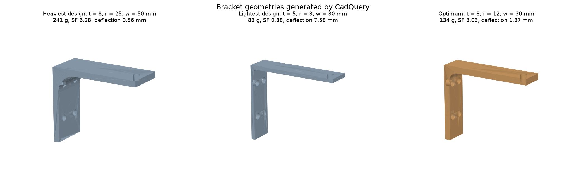
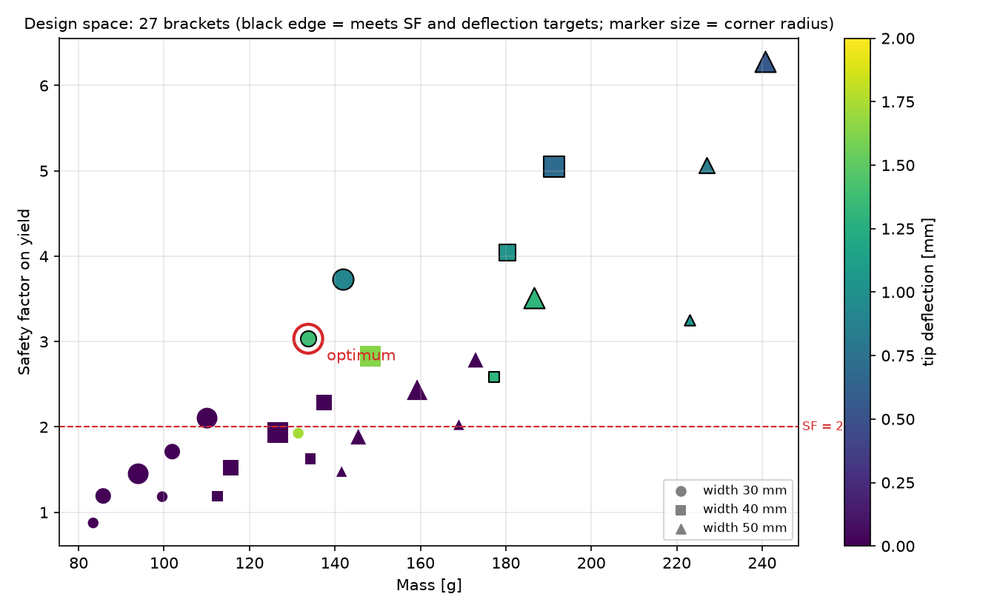
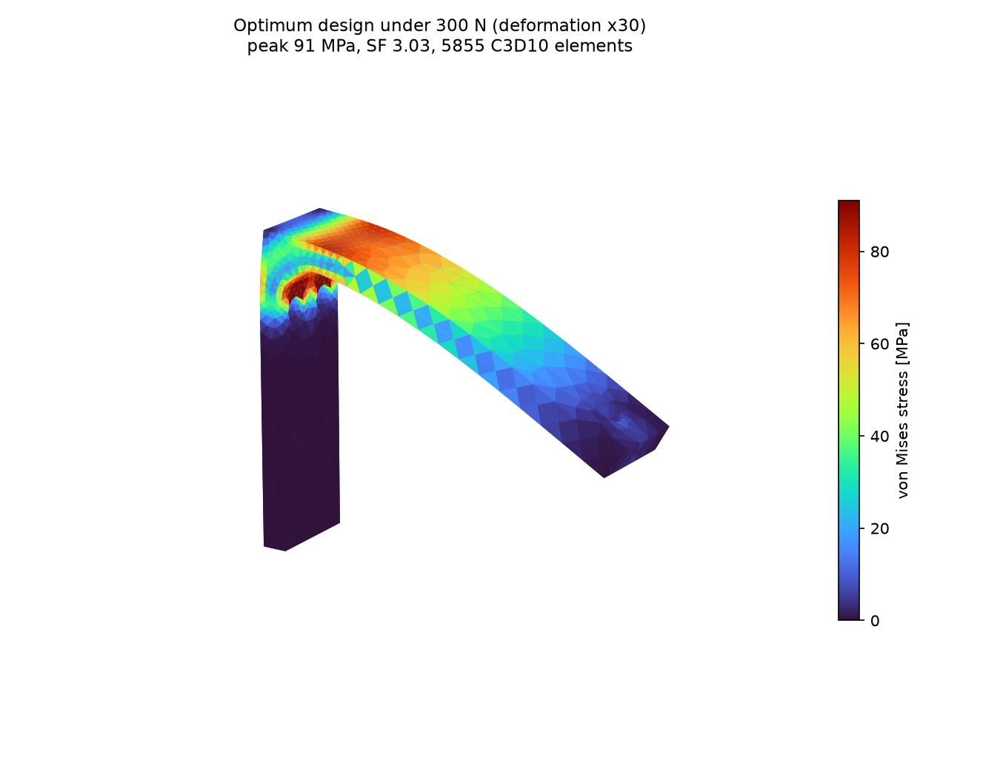
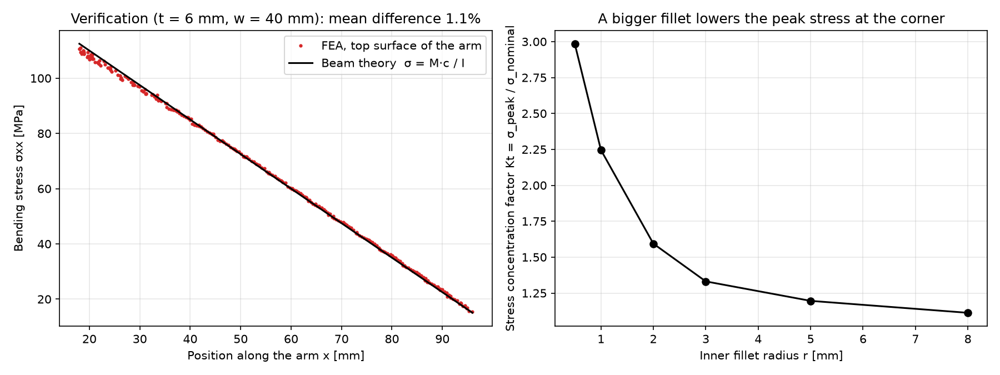
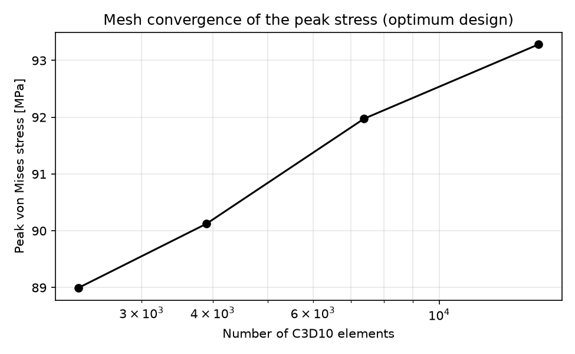

# Parametric Bracket Design: CadQuery + Gmsh + CalculiX

A wall-mounted aluminium shelf bracket, designed entirely from code. One Python script generates the CAD model from three design parameters, meshes it, solves it with a finite element model, and searches the design space for the lightest bracket that meets a safety factor and a stiffness target. The CAD of the chosen design is exported as STEP and STL.



**The chosen design in 3D:** [`results/best_bracket.stl`](results/best_bracket.stl) (GitHub renders STL files interactively, so you can rotate it in the browser).

## The problem

A shelf bracket is bolted to a wall with four M8 bolts and carries **300 N (about 30 kg)** at the tip hole of a 120 mm arm. It is machined from **aluminium 6061-T6** (E = 69 GPa, yield strength 276 MPa).

| Requirement | Value |
|---|---|
| Safety factor on yield | ≥ 2.0 (peak von Mises stress ≤ 138 MPa) |
| Tip deflection | ≤ 1.5 mm (L/80) |
| Objective | minimum mass |

Design parameters:

| Parameter | Values |
|---|---|
| Thickness t | 5, 6, 8 mm |
| Inner corner radius r | 3, 12, 25 mm |
| Width w | 30, 40, 50 mm |

A large inner radius works as a full-width gusset with smooth, tangent transitions, so there are no sharp re-entrant corners that would create stress singularities.

## Workflow

1. **CAD (CadQuery):** plate and arm are built as boxes, joined, the inner edge is filleted (found with a `NearestToPointSelector`), and the bolt and load holes are cut. Exported to STEP.
2. **Mesh (Gmsh):** the STEP is imported, meshed with second-order tetrahedra and refined in the corner region. The Gmsh 10-node tetrahedron is reordered to the CalculiX C3D10 convention (the last two mid-side nodes swap).
3. **Boundary conditions:** the nodes on the four bolt hole surfaces are fixed; the load is spread over the tip hole surface.
4. **Solve (CalculiX):** linear static analysis, 15 models in parallel.
5. **Post-processing:** displacements and nodal stresses are read from the `.frd` file. The peak stress is taken away from the bolts and the load hole (1.5 hole diameters), because point-like constraints and loads create artificial local peaks (Saint-Venant's principle).

## Results

### Design space



| t | r | w | Mass [g] | Peak stress [MPa] | SF | Tip deflection [mm] | Meets targets |
|---|---|---|---|---|---|---|---|
| 5 | 25 | 50 | 159.2 | 113.3 | 2.44 | 2.227 | no (deflection) |
| 6 | 25 | 40 | 148.4 | 97.7 | 2.83 | 1.634 | no (deflection) |
| 6 | 25 | 50 | 186.6 | 78.5 | 3.52 | 1.312 | yes |
| 8 | 3 | 30 | 131.4 | 143.2 | 1.93 | 1.728 | no (both) |
| **8** | **12** | **30** | **133.8** | **91.0** | **3.03** | **1.375** | **yes, lightest** |
| 8 | 3 | 40 | 177.2 | 106.8 | 2.58 | 1.300 | yes |
| 8 | 25 | 50 | 240.7 | 43.9 | 6.28 | 0.561 | yes |

The full table of all 27 designs is in [`results/report.txt`](results/report.txt).

**Optimum: t = 8 mm, r = 12 mm, w = 30 mm, 133.8 g**, peak stress 91 MPa (SF 3.03), tip deflection 1.375 mm.



### Engineering insights

- **The design is stiffness-driven, not strength-driven.** Many thinner designs are strong enough (SF > 2) but bend too much. The optimum has an SF of 3.03, well above the target, because the deflection limit is the active constraint. Deflection scales with 1/t³ through the bending stiffness, so thickness is far more effective than width, which only scales it with 1/w.
- **The corner radius is cheap stiffness and strength.** With the same 8 mm thickness, going from r = 3 mm to r = 12 mm cut the peak stress from 143 to 91 MPa and the deflection from 1.73 to 1.38 mm, for only 2.4 g more aluminium. The best design with the smallest radius needs w = 40 mm and weighs 177.2 g, so the larger radius saves **25% of the mass**.
- **Where it peaks:** the maximum stress sits on the underside of the arm, where the fillet blends into the flat surface (x = 18 mm, close to t + r = 20 mm). The fillet spreads the load, so the peak moves from the corner to the end of the fillet, where the arm section becomes thin again and the bending moment is still high.

### Verification against beam theory



Along the top surface of the arm (t = 6 mm, w = 40 mm), the FEA bending stress follows σ = M·c / I with a **mean difference of 1.1%**, away from the corner and the load hole.

### Stress concentration at the corner

| Fillet radius [mm] | 0.5 | 1 | 2 | 3 | 5 | 8 |
|---|---|---|---|---|---|---|
| Kt = σ_peak / σ_nominal | 2.99 | 2.25 | 1.59 | 1.33 | 1.20 | 1.11 |

A 0.5 mm radius nearly triples the stress at the corner; an 8 mm radius brings it within 11% of the nominal beam stress. This is the classic reason why sharp internal corners are avoided in machined parts, especially under fatigue loading.

### Mesh convergence (optimum design)



| Element size [mm] | Elements | Peak stress [MPa] | Tip deflection [mm] |
|---|---|---|---|
| 12.8 | 2,324 | 89.0 | 1.3684 |
| 8.8 | 3,900 | 90.1 | 1.3727 |
| 6.4 | 7,382 | 92.0 | 1.3752 |
| 4.8 | 14,961 | 93.3 | 1.3763 |

The deflection is converged to 0.1%. The peak stress changes by 1.4% in the last refinement. The design sweep uses the 7.2 mm mesh (about 6,000 elements per design to keep 27 designs fast), which underestimates the peak stress by about 2.5% compared to the finest mesh. Even with the finest-mesh value of 93.3 MPa, the optimum keeps a safety factor of 2.96, so the conclusion does not change.

## How to run

Linux or WSL, with CalculiX (`sudo apt install calculix-ccx`) and a Python virtual environment:

```bash
python3 -m venv ~/venv-cad
source ~/venv-cad/bin/activate
pip install cadquery matplotlib gmsh
python bracket_design.py
```

The whole study (27 designs, verification, fillet study and mesh convergence, 38 FE models) runs in a few minutes, with the CalculiX jobs in parallel.

## Limitations

- Linear elastic, small displacements; bolts modelled as fixed hole surfaces (no bolt preload or wall contact).
- Static strength only. A real bracket under repeated loads would also need a fatigue check, where the corner Kt matters even more.
- Possible extensions: a continuous optimizer instead of a grid sweep, lightening pockets, and fatigue life with an S-N curve.
